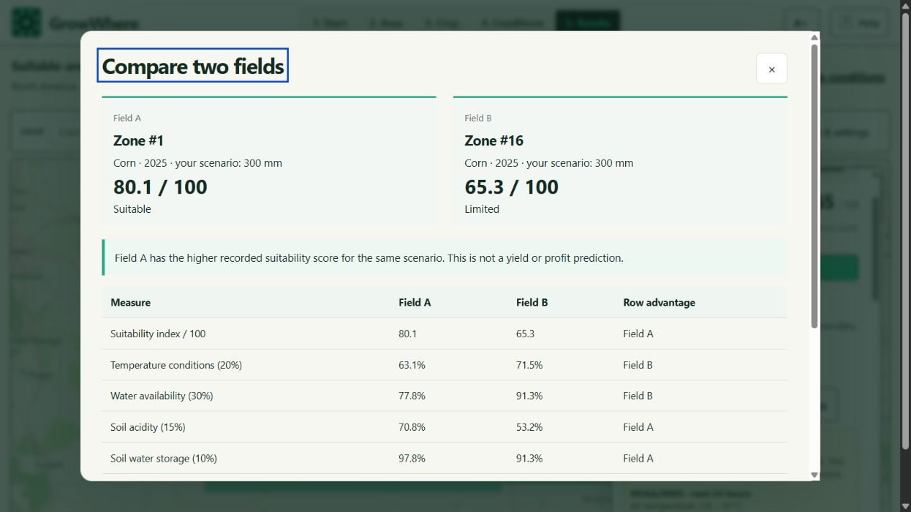

# GrowWhere

**Explore crop suitability on a map with NASA data.**

GrowWhere is a prototype by **RightVersion** for **Field Shift: Adapting Farms
with NASA Data**, a NASA International Space Apps Challenge task. It combines
NASA POWER weather data with USDA soil, land-cover and historical economic
information so farmers can explore crop and water scenarios, compare two
fields, and inspect how an estimate was calculated.

**Current scored coverage: the Kansas pilot, historical season 2025.** The map
supports North American navigation; unprepared areas and scenarios show **No data**.

## Demo and submission

- [Public demonstration: 7 slides, including title and introduction](https://github.com/EgorStalker/GrowWhere/blob/main/deliverables/GrowWhere-demo/GrowWhere-demo.pdf)
- [Presentation file](https://github.com/EgorStalker/GrowWhere/blob/main/deliverables/GrowWhere-demo/GrowWhere-demo.pptx)
- [Project summary and details for the submission form](docs/submission.en.md)
- [NASA and other resources, with full public URLs](docs/submission-resources.md)
- [Updated slide 5–7 copy and screenshots](deliverables/GrowWhere-demo/slide-copy.md)

The demonstration is separate from the longer analytical PDF reports generated
by the app. The repository is the public project link; the Python API runs locally.



## What works

- Choose **I have a field** and draw a boundary, or **Find suitable areas**.
- Explore seven crops: spring wheat, soybeans, corn, sorghum, spring barley,
  oats and cotton.
- Set an irrigation scenario and inspect suitable, limited, unsuitable,
  excluded and missing-data zones on a real Leaflet map.
- Read prepared, versioned map products from SQLite instead of recalculating
  scores for every pan or zoom. Adjacent zones of the same class are joined
  visually while the original observations and No data gaps are preserved.
- Compare two selected zones or two drawn boundaries. Field A remains saved
  while field B is explored. Different scenarios are flagged, and missing
  values do not become numerical advantages.
- Download a field or comparison PDF with the seven factors, applied
  aggregation, source versions, data gaps and a complete equation appendix,
  including FAO-56 ET₀ and crop coefficients.
- View historical USDA ERS costs and harvest prices as context for crop choice.

## Run locally

Requirements: Python **3.11+**, internet access for source preparation and map
tiles, and Matplotlib for PDF export. Node.js **18+** is needed only for the
JavaScript tests or the optional npm launcher. Leaflet is included locally;
there is no JavaScript build step.

From the repository root on Windows:

```powershell
py -3 -m pip install -r apps/web/prototype/requirements.txt
py -3 data/pipelines/precompute_maps.py --bbox=-102.1,36.9,-94.5,40.1 --crops wheat,soy,corn,sorghum,barley,oats,cotton --year 2025 --rainfed --zoom 8
py -3 apps/web/prototype/server/server.py
```

Open **http://127.0.0.1:4173/**. On Linux/macOS, use `python3` in place of `py -3`.
The Windows launcher is `apps/web/prototype/Start-GrowWhere.cmd`.

The raw source cache and processed SQLite database are local generated files
and are excluded from Git. A fresh clone must prepare its map products before
scores are available. Initial preparation depends on upstream availability.
The command above prepares the explicitly rainfed scenario. To prepare other
water scenarios, replace `--rainfed` with `--irrigation-mm 150`, `300` or `450`.
See the [prepared-map contract](docs/prepared-maps.md) for unknown irrigation,
versioning, expiry, offline builds and refresh commands.

Source updates require an explicit preparation job. A background update
scheduler and fully prepared continental coverage are future work. Map requests
themselves do not fetch upstream analytical inputs.

## Calculation

The experimental index combines temperature, water availability, pH, available
water capacity, drainage, slope and texture. With complete point observations:

```text
G = 100 * exp(sum(w_i * ln(f_i)))
S = min(G, 100 * sqrt(min(f_i))) if min(f_i) < 0.10; otherwise S = G
Known zero factor -> S = 0. Missing critical input -> No data.
```

Prepared overview cells use a five-point sample mean. A drawn-field summary
uses the existing area-weighted zone calculation. Applying the nonlinear
formula to averaged factors would produce a different result, so the PDF
distinguishes those operations and documents missing intermediate inputs.
Full equations: [methodology](docs/live-methodology.md) and
[field reports](docs/field-reports.md).

## Data and limits

NASA POWER supplies historical meteorological inputs for the water and
temperature calculations. USDA SSURGO provides soil information, USDA CDL
checks land cover, and ERS supplies annual economic context. Optional NASA GIBS
layers provide MODIS NDVI and SMAP moisture imagery; these visual layers are
separate from the numerical index. NOAA NWS and K-State guidance are used in
the separate planning-readiness check. [Resource inventory](docs/submission-resources.md).

This is research screening without field calibration. Climate support is
coarse (about 55 km); drawing a small field does not create field-level weather
measurements. Current area weighting uses whole intersecting zones rather than
exact clipped intersections; geometric coverage percentage is unavailable.
The app does not establish a sowing date, recommended irrigation amount,
current market demand, guaranteed yield or profit. NASA and USDA supply data;
the uncalibrated scoring weights and thresholds belong to the GrowWhere method.

## Development and tests

```powershell
cd apps/web/prototype
py -3 scripts/test.py
node --test scripts/*.test.mjs
```

The integration was checked with **110 Python tests and 61 JavaScript tests**,
real prepared-map requests, PDF generation and browser flows for selected zones
and drawn boundaries. Those checks verify implementation behavior, not
agronomic accuracy.

| Path | Contents |
| --- | --- |
| `apps/web/prototype/dist/` | Maintained HTML, CSS, JavaScript and local Leaflet assets |
| `apps/web/prototype/server/` | Local HTTP API and PDF endpoint |
| `data/pipelines/growwhere/` | Source adapters, scoring, SQLite products and PDF equations |
| `data/pipelines/precompute_maps.py` | Explicit map preparation job |
| `docs/` | Method, contracts, coverage, submission text and decisions |
| `deliverables/GrowWhere-demo/` | Public demo, slide copy and screenshots |

Contributors and AI agents start at [AGENTS.md](AGENTS.md). Team documentation
and communication are Ukrainian; the product and submission materials are English.
Third-party materials retain their own terms; see [THIRD_PARTY.md](THIRD_PARTY.md).
